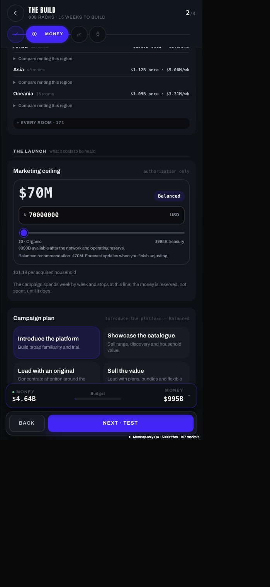
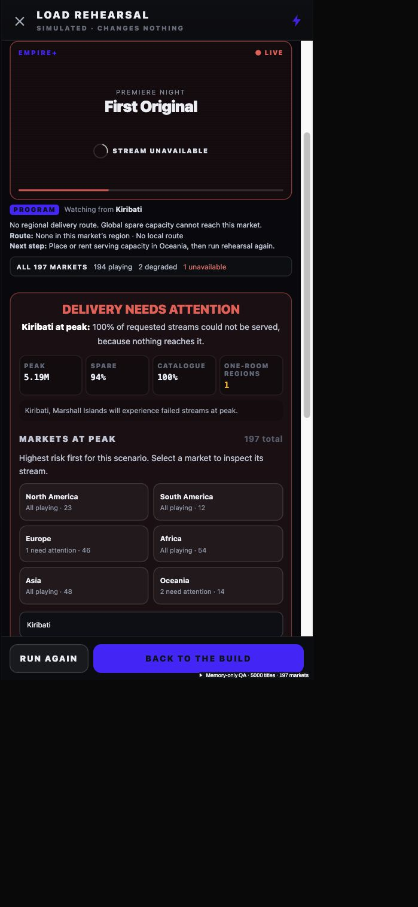

# Build flow corrections — 21 October 2026

Implemented the approved marketing, forecast/rehearsal, repair navigation and commissioning layout scope. Existing unrelated uncommitted network-suggestion work was preserved.

## Changes

- Marketing uses a treasury-scaled slider and exact USD entry. The campaign tier is derived from market-specific recommendation ranges. Slider updates stay local until release; treasury shortfalls and other commitments remain visible. Campaign objectives, timing, country allocation and pricing remain connected to the canonical forecast.
- Startup time and route latency are separate fields. Network/Test country services reuse the same likely-scenario route evidence as rehearsal. Geographic reach is applied to routed demand rather than turning any nonzero signal into whole-country service.
- Partial delivery loss is degraded playback; an absent route is unavailable. Successful protected-burst delivery is playing when loss is zero and buffering risk is low. The engine's underlying verdicts and commissioning checks remain in force.
- Rehearsal starts on the largest audience and permits country selection in one searchable, region-grouped browser. Duplicate viewer screens and long repeated country result lists were removed. The monitor responds to the selected market and load phase. Scenario evidence is fixed to the drawing used to open the rehearsal.
- Regional strips fit 197 markets inside the Test card. Viewer gaps are explicit; global owned capacity and protected burst are labelled separately. Regional Strong labels disclose countries needing attention.
- Repair routes open the affected Network region or Content rights editor. Required delivery fixes and optional headroom/resilience are separated. Physical repairs target the actual limiting resource rather than blindly selecting the first upgrade. Supported room upgrades are draft-only and use canonical commissioning costs.
- Commissioning Schedule A starts with six regional groups, then provider/site details. Before-you-sign checks and charging semantics remain.
- Passive callback/evidence refreshes do not notify configuration-edit persistence. Large infrastructure signatures are compacted before they reach the 640-character save field. Existing valid short signatures stay unchanged. Full topology changes still invalidate evidence, including changes near the end of a long network. Previously truncated evidence requires a fresh rehearsal; it is never silently approved.

## Verification

- Seven deterministic rehearsal regression tests: partial failure, missing routes, partial geographic reach, phase-aware playback, healthy burst playback, physical repair selection and route diagnostics.
- Seventeen canonical forecast/signature tests, including worldwide topology save normalization and genuine-edit invalidation.
- Marketing forecast, UI, lifecycle and Build adapter audits.
- Build Test/autosave/commissioning gates and physical infrastructure audit.
- Network suggestion preservation, current-input Apply validation, cancellation and treasury limits.
- 5,000-title / 197-country disposable reconciliation: source player and licences unchanged, matching service/rehearsal startup, no failed country falsely operational, quiet/likely/surge ordering, bounded commissioning groups. Three-scenario model read was 11.2 ms in the final concurrent test run; this is a Node model measurement, not phone tap latency.
- TypeScript and full production build checked. Existing large-bundle warnings remain.

## Scope and limits

The main Anshu save was not commissioned, advanced or purchased against. Browser gameplay uses a memory-only disposable 5,000-title fixture. Actual route gaps remain visible; this work does not turn an incomplete network into an approved launch.

The 5,000-title full-HQ cold open remains heavy. This report does not certify instant performance on physical Android/iOS devices. The current correct-checkout development server remains at http://localhost:5174/.

## Browser evidence and remaining performance

The final production QA uses the existing memory-only 5,000-title / 197-country fixture, not career storage. Verified: China starts Playing during audience arrival; a country search switches the single monitor to Kiribati and correctly reports no route; Oceania repair opens the Oceania Network editor; commissioning remains blocked for real coverage and founder-readiness gaps; the agreement starts with six regional groups.

After the signature fix, a completed rehearsal remains visible on Launch as **It broke**, replacing the prior false **Not run** state. This is an actual retained result, not a green result. Changing marketing from $0 to $70M sets the derived tier to Balanced, changes audience/concurrency forecasts and correctly invalidates that prior evidence.

Measured two-rAF event-to-next-paint proxies from the final browser session: cold Build 6,024ms, warm Test 40.8ms, rehearsal open 42.8ms, Run 14.4ms, return 13.4ms, Launch 14.4ms, Money 30.5ms. Maximum observed session long task was 9,185ms; this is not a separately instrumented budget-tap latency. The 5,000-title full-HQ cold open and large save/forecast update remain performance limitations and are not certified instant. See stress-session-metrics.json.

The browser viewport override did not resize this background tab to the requested narrow viewport: actual measured document width was 524 CSS px, panel width 520px. Budget fields had no internal overflow there. The screenshot is therefore labelled layout, not a claimed 320px device verification. Physical Android/iPhone testing has not been performed.

