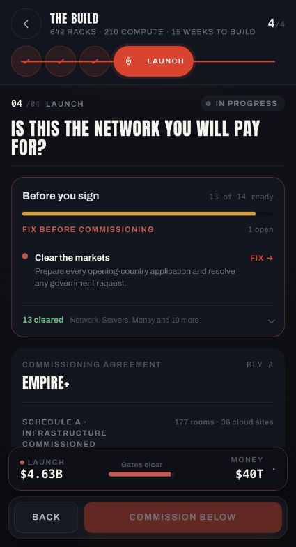
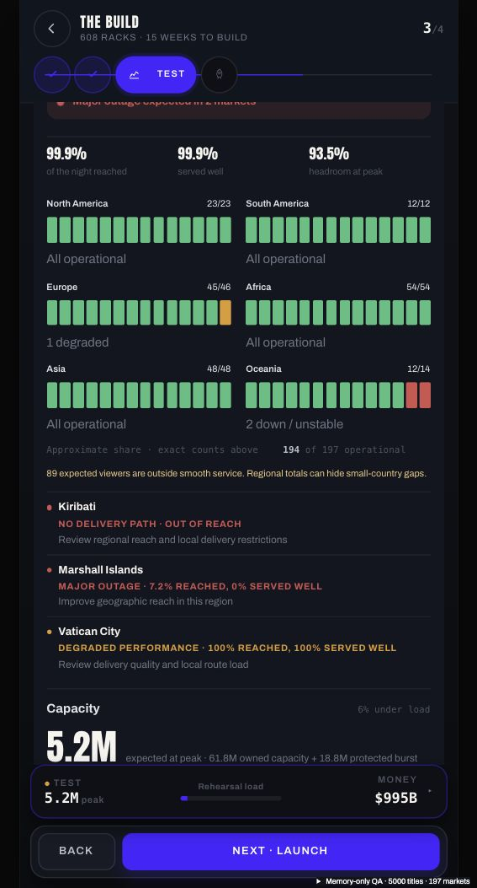
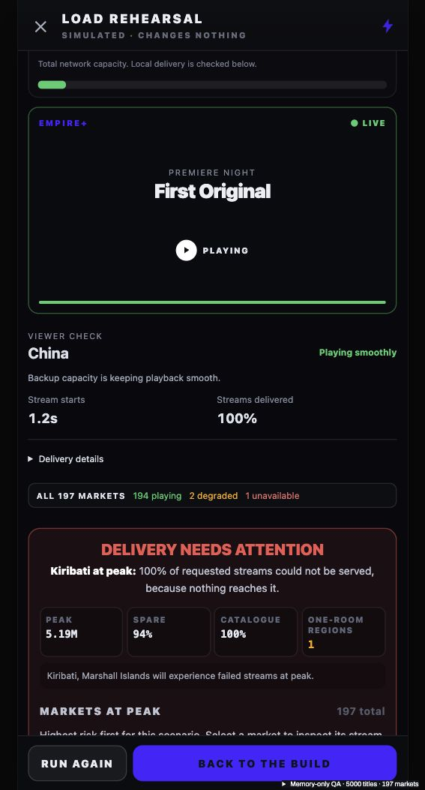

# Build status and rehearsal polish — 21 October 2026

## Changes

- Every regional status strip has 14 equal segments. Colors approximate the share of operational, degraded, and unstable/unavailable markets. Each nonzero severity gets at least one segment; exact market counts remain visible, so a small outage never disappears through rounding. A strip represents a region, not 14 individual countries.
- Rehearsal telemetry says “Viewers watching now” / “Peak viewers together” and labels owned capacity, unused capacity, and percentage in use separately. Demand-scaled charts no longer show a dashed legend for an invisible capacity line. The capacity gauge reflects global load; local delivery failures remain visible in the market result.
- Viewer check shows the country, playback status, startup time, and delivered-stream percentage. The full route, diagnosis and recommendation are available under Delivery details rather than three expanded paragraphs.
- Network region/World focus belongs to the wizard, rather than the unmounted Network page. Repair navigation explicitly selects its target region. Returning from Test or closing rehearsal preserves the previous selection.
- Commissioning and stage status use canonical provider physical constraints, including expanded cloud contracts. The generic draft estimate previously used base listing ceilings and treated equality as a shortage. Exactly-full rooms are now valid; genuine canonical constraints still block. Room projections are cached for an unchanged immutable draft, preventing repeated gate/map reads from rebuilding them.
- Small but real failed audiences display `<0.1%` instead of a misleading `0%` aggregate. This changes presentation only; simulation verdicts and saved evidence are unchanged.

## Real Anshu draft verification

Read-only navigation in the existing local game at http://localhost:5174/:

| Check | Before final correction | After |
| --- | --- | --- |
| Readiness | 12/14; room capacity + market clearance open | 13/14; only market clearance open |
| Network stage | Needs a look | Settled |
| Treasury | $40T | $40T |
| Setup due | $4.63B | $4.63B |
| Drawing | 642 racks + 210 cloud compute | Same |
| Rehearsal | Surge held by renting | Same evidence retained |

The original screenshot reported three constrained rooms. On the first real-draft recheck after the generic estimate/boundary correction, one warning remained. Using the canonical provider constraint removed that remaining false warning. No purchase, upgrade, commissioning, or week advance was performed. The real tab is left on Test.

## Disposable browser verification

A memory-only production UI fixture with 5,000 licences and 197 markets was used for gameplay tests; no career storage writes:

- Six strips each rendered 14 segments at the same measured width. Europe retained its one degraded market; Oceania retained two unstable/unavailable markets.
- Asia stayed selected after Test navigation and a complete rehearsal/return cycle.
- Improve coverage opened Oceania. Choosing World afterwards stayed World through another Test/Network cycle; an old repair focus did not override it.
- China played smoothly while using protected burst; the short viewer facts and collapsed delivery details were correct. Searching/selecting Kiribati showed Unavailable, no connection, and 0% delivered.
- Genuine coverage/readiness blockers remained; no commission was executed.

## Automated checks

- `scripts/audit-streaming-build-status-polish.tsx`: exact resource boundaries, overflow protection, canonical provider constraints, all good/bad count combinations for 1–197 markets, mixed severity visibility, and small-market aggregate wording.
- Build Test/autosave/commissioning gates; seven rehearsal regressions; physical infrastructure; Build Phase 4 UI.
- 5,000-title/197-country reconciliation: source player/rights unchanged, matching service/rehearsal data, canonical quote unchanged after reads, cached room projection reused, and a changed drawing gets a fresh projection.
- TypeScript, production build, and diff whitespace verification.

This is a UI/state/readiness correction. It does not resolve or certify the previously measured heavy 5,000-title full-HQ cold open, and no physical Android/iPhone performance certification was performed. Existing production bundle-size warnings remain.
