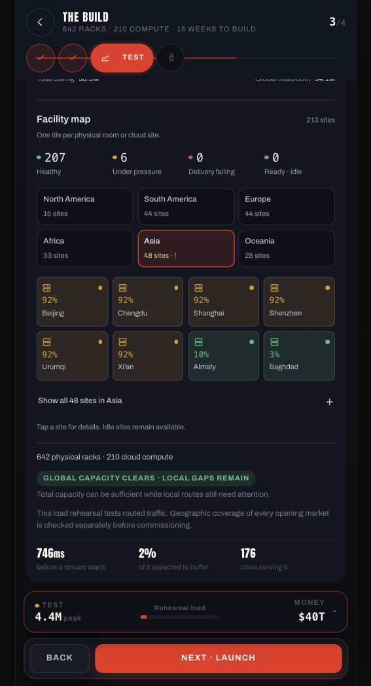
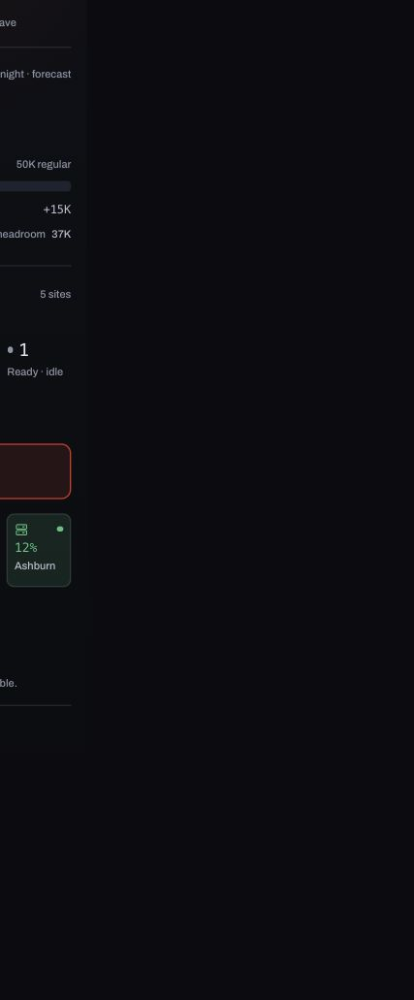

# Facility map and capacity display — 21 October 2026

> Superseded design iteration: the Facility Map was removed after user feedback. The current presentation is the [simplified capacity meter](../2026-10-21-capacity-meter/README.md). Measurements and screenshots below describe the earlier iteration.

Replaced the proportional cabinet illustration with a forecast of actual physical rooms and cloud sites. The old grid capped drawing at 480 symbols, then derived a “rented” count from capacity share; that was not an inventory count.

## Display and semantics

- Regular capacity has one labelled demand meter. Extra burst allowance, total ceiling, and global headroom are separate. Anshu's 4.4M likely demand is about 6% of 75.5M regular capacity; the old 4% used the combined 98.5M ceiling.
- One tile identifies one actual room or cloud site. The initial map shows at most eight sites in the selected region; show-all/collapse and site details are local UI state.
- Green means healthy delivery; amber means high load, burst reliance, or an actual physical/reliability constraint. Any forecast delivery loss remains red. Idle means available with no routed demand. Missing data is explicitly No forecast.
- Normal capacity derating already included in usable capacity does not independently turn every quiet site amber. Actual canonical physical constraints and reliability risks still do.
- Physical/cloud identity uses icons and labels, independently of health colour. Site details show the real server mix, routed peak traffic, regular capacity and burst ceiling. No per-machine online/offline status is invented.
- All results are labelled likely-night forecasts, independently of the last saved rehearsal's scenario. Save, rights, commissioning and rehearsal-evidence services were not changed.

## Actual Anshu draft

Verified in the existing local career: 213 sites, 207 healthy and six under pressure; 642 physical racks plus 210 cloud compute. The six Chinese delivery sites are at 92% regular load in the likely forecast. Beijing details show four Titans, 412.6K expected traffic, 449.3K regular capacity and 585K with burst. The previous Surge rehearsal still reports its own 121% load; these are different, labelled scenarios.

The existing Anshu save was reopened after a development reload and left on Build → Test. No week advance, purchase, upgrade or commissioning was performed.

## Verification

- Semantic/SSR audit: missing forecasts, exact site identity, actual unit counts, physical/cloud distinction, healthy/burst/partial-loss/failing/idle states, real physical/reliability constraints, planned derating, unknown geography, and immutable draft reads.
- Canonical 5,000-title / 197-market fixture: 171 actual sites, 165 healthy and six under pressure. No missing metrics or duplicate identities. Source player, licences and canonical quote unchanged after rendering. Projection was 2.2ms and SSR render 19.5ms in the final concurrent Node check; these are model/render measurements, not device tap latency.
- 52-title / 197-market save without infrastructure: empty-state rendering, zero invented sites and unchanged source save.
- Existing Build/autosave/gates, Build Phase 4 UI, and seven rehearsal regressions passed. TypeScript and production build passed; existing bundle-size warnings remain.
- Controlled 320px container: 288px panel content with no internal overflow; all tile targets measured 66.75 × 76px. All five health states rendered, including idle cloud and unknown data. Enter activated the idle cloud tile and displayed the correct available/no-traffic explanation. This is container-layout verification, not physical phone certification.

## Interaction timings and limits

The memory-only production UI fixture's two-rAF event-to-next-paint proxies were: Test 31.1ms, site details 17.3ms, close 16.9ms, region switch 12.6ms, expand 12.0ms and collapse 11.9ms. See browser-metrics.json. These numbers describe this local browser run.

The full-HQ cold Build transition remained 4,346.1ms in that 5,000-title session. This display change does not claim to resolve that existing cold-open limitation. No physical Android/iPhone performance certification was performed.
