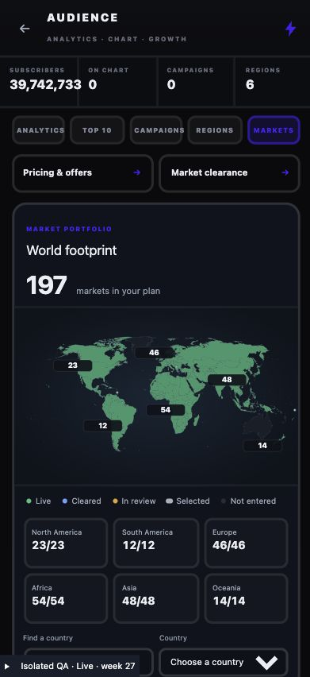
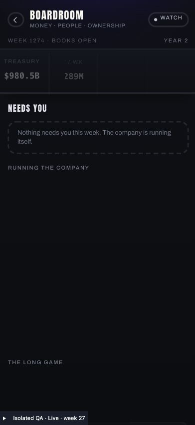

# Streaming Operations integration — 21 October 2026

Implemented the approved four-division integration on top of checkpoint `612efbb`. Existing Content, Platform, Audience and Boardroom layouts remain; the additions are focused controls and selective visual improvements. No new top-level Operations divisions and no replay of the launch wizard for ongoing service settings.

## What lives where

| Division | Implemented destinations |
| --- | --- |
| Audience | Existing Analytics, Top 10, Campaigns, Regions and Markets are exposed from HQ, with Pricing & offers and Market clearance inside the desk. Industry/platform maps share world, region and country context. |
| Content | Existing Catalogue, Content Market, Originals, Rights, Localization and Slate retained. Completed language assets now survive beyond the old global 320-record persistence cap. |
| Platform | Existing status/delivery/technology/product/history remain. Current Network, Playback ident and Storefront controls appear inside the desk and as HQ shortcuts. Live Network uses Network / Load rehearsal / Review revision tabs. |
| Boardroom | Existing Finance, leadership, ownership, IPO, brief and legacy retained. M&A moved here from Audience and added to the existing Boardroom section list. |

## Service and save behaviour

- Pricing, ident and storefront use focused editors loaded from the current service, with local previews and explicit Save. Close discards unsaved edits. Launch draft autosave, step progression and blueprint checkpointing do not run in Operations. Price/storefront previews no longer claim to be autosaved/applied before Save.
- Canonical configuration APIs retain their opening-only guard by default. An explicit Operations context permits active service changes. Research, ident package affordability and package receipts still apply. Duplicate saves do not charge or increment revisions. Signed launch records, live launch programme, existing licences and current customer snapshots remain unchanged by these saves.
- Saved pricing enters the next canonical customer offer/weekly settlement. Saving does not immediately debit customers or rewrite the completed customer week. This retains the existing billing model; no new annual-contract or retroactive billing policy is introduced.
- Live Network approvals call the canonical infrastructure revision service, rather than opening commissioning. An exact-configuration load test is required. Construction becomes a pending revision; current delivery remains in service. Duplicate approvals cannot debit again. Custom live prices no longer have to fit the old three-tier infrastructure ladder; network revisions cannot edit those prices.
- Revision totals and bills use the canonical incremental transaction quote, not a fresh purchase of the entire existing network. Past opening marketing is not reserved again. Region cards describe asset value; the review shows the amount payable. An unchanged network quotes zero new construction time.
- Expansion planning/filing keeps the signed launch programme intact, retains existing filed/active records, charges canonical fees/energy and refuses duplicate filing. Filed expansion countries participate in the live Build footprint.
- Recommendation choices open the growth review with the chosen objective loaded; the normal Lock next growth week action persists it. Prelaunch recommendations are explicitly unavailable; + New opens a focused opening-campaign editor using the existing marketing slider, forecast and cost rules.

## Audience visuals and definitions

- The industry model now includes all 197 countries rather than only the 24 authored launch cards. The footprint includes current non-exited operations, including expansion.
- Industry viewers are explicitly labelled modelled or settled. Your Platform shows settled paid accounts from canonical country summaries, never a fabricated allocation of global subscribers or a concurrent-viewer number. Missing settled data is labelled unavailable.
- The market map distinguishes live, cleared, in-review, selected and not-entered countries. Zero live markets is displayed alongside selected/filed progress. Six regional summaries and one selected-country card replace a giant default country scroll.
- The country portfolio initially renders eight entries, filtered by the current region/country. Clearance mounts one region's countries and opens the selected country or an outstanding request. Deep industry economics remain available behind a disclosure.
- Audience tab/region/country selection survives editor detours. Network pricing detours return to the network manager. Existing charts, Content posters/shelves and Boardroom finance presentation remain.

## Fresh verification

- New Operations service audit passes: guarded opening callers; live configuration save/reload; immutable rights, launch receipt/programme and customer state; exact $4.5M ident charge and duplicate/no-cash/research refusals; storefront save; all 197 countries; expansion filing with duplicate refusal; exact rehearsal and canonical pending revision/debit; separate price authority; existing assets plus 5,000 additional language assets retained; next-week canonical customer offer and settlement reads the saved $11.49 price.
- New UI/adapter audit passes: focused Pricing, Ident, Storefront, Markets and Clearance; no sequential launch navigation; bounded country controls; Network/Test/Review; canonical incremental quote flows into the displayed bill; historical opening marketing is not re-reserved.
- Existing scope audits pass: global localization, infrastructure Phase 5, launch draft continuity, opening programme, Build Test/autosave gates, save generations and rights transactions Phase 6. Shared localization/opening/autosave gates were rerun after the final shared-component changes.
- Career bridge/render checks pass on 52- and 5,000-title / 197-country fixtures. Warm SSR observations were 7.8ms and 11.0ms respectively; these are model/render observations, not browser tap latency.
- TypeScript exit 0; production build exit 0 (15.86s); machine-readable results are recorded in [verification.json](verification.json). Existing large-chunk/Browserslist notices remain. `git diff --check` passes.

## Browser checks

All mutations were inside a disposable React-memory HQ. No saved Anshu career purchase, commission, cheat or week advancement was performed by these tests.

Verified live Pricing edit → preview leaves canonical $7.99 unchanged → Save records $11.49 → another $15.99 edit followed by Close retains $11.49. Treasury, launch status and 55 rights records stayed unchanged. Storefront cinema → shelves also remained preview-only until Save. FULL ident package charged exactly $4.5M at Save; repeating Save did not debit again. Catalogue discovery reached the review and locked the canonical next growth week. The actual Platform and Boardroom desks expose their new controls.

Verified Markets → India → clearance opens Asia / IN with 48 country tabs, then Close returns to the Markets tab with India/Asia selected. The live Network review shows the incremental quote and requires fresh rehearsal, without an opening launch checklist.

Responsive checks use a controlled iframe because the host in-app browser's viewport/zoom changes do not reliably produce the requested page width. The 393px frame measured 393px document width with no map overflow. The requested 320px frame measured 321px due to host fractional zoom; campaign and Pricing each had document/panel/scroll width 321px. These are controlled browser checks, not physical-phone certification. Screenshot clipping accounts for the browser's reported screenshot scale.

## Existing failures and limits retained

Two broader audits fail on both the unchanged checkpoint overlay and this implementation, with identical assertions: Audience persona percentages sum exactly to 100, and promoted-title discovery percentages reconcile to 100. Expectations were not weakened to produce green output.

A full-game-week probe of the same prepared 197-market live fixture reached `world_streaming_viewing_rival_viewing_ready` and then exceeded a 45-second bound on both checkpoint and current source. The canonical customer settlement passed separately. The full game-week path is therefore not certified complete or fast; this pre-existing viewing-stage stall needs separate investigation. Operations success is not an overall streaming release green light.

Removing the localization cap prevents future valid assets from being discarded; it cannot recreate records already lost in an older save. The previous checkpoint described the limit as per-title; source inspection established that it was a global title-language asset array cap.

Raw player fixtures stay outside Git. Fixture-dependent audits require local preparation; the QA HTML requires the local middleware documented in the implementation session. No new dependency or save-schema version was added. Changes remain local for review; no new push/PR was requested in this implementation turn.

## Reproduce the isolated browser harness

Prepare disposable player JSON outside the repository, then run:

```sh
STREAMING_OPERATIONS_LIVE_FIXTURE=/tmp/streaming-operations-live.json \
STREAMING_OPERATIONS_PRELAUNCH_FIXTURE=/tmp/network-suggestion-seed.json \
STREAMING_OPERATIONS_SCALE_FIXTURE=/tmp/network-suggestion-5000-player.json \
./node_modules/.bin/vite --config lab/streamingOperationsVite.config.mjs
```

Open `http://127.0.0.1:5176/scripts/fixtures/streaming-operations-responsive.html?width=393` or `?width=320&case=prelaunch`. The server requires explicitly configured frozen fixtures and returns an explanatory error if missing. It does not read app save slots. It is separate from the actual game at `http://localhost:5174/`.





## Local handoff

The actual game remains on `http://localhost:5174/`, Vite PID 6921 with cwd `/Users/zeesh/Vibe code/Actor empire`. Browser tab identity and rendered Actor Empire version 1.0.25 start screen were verified. Load the existing career through the normal menu to test Streaming → Operations. The agent-created QA tab was closed, the temporary viewport override reset, and the isolated port 5176 server stopped. No test fixture was loaded into actual career storage.
