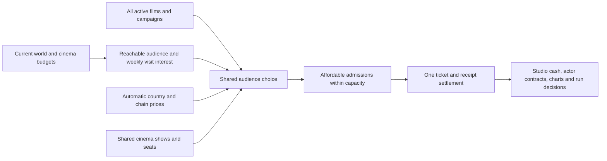

# Fair box-office revamp: research and discussion draft

22 October 2026. The user approved this core direction and then requested deeper audience behavior and wider reuse of streaming systems. The [refined design proposal](refined-design.md) consolidates those additions for final discussion. This document records the initial brainstorm; it is not an implemented economy. It extends the [current-system audit](report.md). Gameplay source, existing saves and contracts have not been edited.

Confirmed user preference: **ticket prices should be automatic by country and cinema chain**. Players would continue making production, campaign, release-footprint and timing choices.

## Recommendation

Build one shared theatrical market using the existing world population, audience cohorts and cinema participation budgets. Earn revenue from tickets actually bought within audience, spending and screening constraints. Use that settlement for owned films, offered acting projects and NPC films.

Fix the current acceptance/accounting defects first, then calibrate this market. A universal revenue reduction would make already-disadvantaged offered roles worse. Population multiplied by a new demand percentage would still be generous if every film could independently claim the same people and money.

Fairness means understandable risk, consistent rules and meaningful choices. It does not mean every well-made film succeeds, every studio gets a fixed win rate, or expensive production guarantees a bigger audience.

## What the screenshot establishes

The supplied image is player feedback and visual evidence, not a save-state trace:

| Visible detail | Reading |
|---|---|
| Animated comedy: $189.7M budget; $3,023.4M gross | About 15.94× production budget in public ticket gross. This is not a studio-profit calculation. |
| Animated weeks: $721.6M → $982.7M → $1,319.0M | Growth of about 36.2%, then 34.2%. The current engine can generate this kind of compounding. |
| Live-action superhero: $169.6M budget; $3,531.4M gross | Already above $3B; about 20.82× budget. An exact universal $3B wall does not explain this image. |
| Superhero latest visible weeks: $615.4M → $115.7M | Roughly an 81.2% drop. Cap headroom clipping is a plausible cause, not proven for this specific save. |
| Superhero Run W7 with six weekly bars | Current card uses the next `weekNum`, which advances after a processed week. Do not interpret the label as seven completed receipts. |
| Feedback says removal happens around 3000M | A reported repeated pattern. Current dynamic caps can create a practical wall, with a clipped week followed by zero headroom and withdrawal. |

The last visible superhero week is still far above the current 5%-of-budget pull threshold ($8.48M), so that screenshot alone does not show ordinary low-revenue withdrawal. It also does not show the actual removal, cap value, region/cinema footprint or hidden stats. We should not assert the exact withdrawal cause without those facts.

The useful correction to the previous finding is: **“no fixed $3B constant” does not mean “no cap-wall problem.”** Strong films can repeatedly run into dynamic ceilings instead of ending through declining audience demand.

## What is already available to reuse

| Existing system | Verified useful inputs | Missing for theatrical settlement |
|---|---|---|
| World population | Country population, households, age bands, income bands, languages, cinema access, macro indicators | A film-specific reachable audience, visit history and screening inventory |
| Audience economy | Country/income/persona cohorts; household entertainment budget; price sensitivity and life stage | Shared access to the existing streaming genre/persona mapping, with cinema-specific calibration |
| Participation | Cinema-only, streaming-only, dual and neither groups; cinema interest, eligibility and monthly cinema budget | Actual ticket purchases, wallet debits and title competition |
| Cinema chains | Region screens, cinema share, booking costs and audience positioning | Country capacities, seats, shows, film show shares and ticket prices |
| Canonical industry | Project IDs, producer ownership, scheduled releases and released projects | One common weekly admissions result for every owner |
| Streaming commerce | Shared cohort wallets, integer cents, order-independent allocation and exactly-once settlement patterns | Cinema-specific purchases and admission units |

Sources: [population types](</Users/zeesh/Vibe code/Actor empire/types.ts:9959>), [cohorts](</Users/zeesh/Vibe code/Actor empire/services/worldEconomy/worldAudienceCohorts.ts:19>), [cinema participation](</Users/zeesh/Vibe code/Actor empire/services/worldEconomy/worldAudienceParticipation.ts:79>), [cinema terms](</Users/zeesh/Vibe code/Actor empire/services/cinemaChains.ts:22>), [industry projection](</Users/zeesh/Vibe code/Actor empire/services/industryWorld/publicIndustryProjection.ts:30>), [shared spending pattern](</Users/zeesh/Vibe code/Actor empire/services/worldEconomy/worldStreamingCommercialEconomy.ts:59>).

These country and income models are synthetic game parameters. They are not verified national demographic or box-office datasets. Current macro variation is a deterministic progression with periodic movement, not a complete recession/shock simulator. The cohort `personaAffinity` vector describes affinity between six personas; deeper tracing also found a separate genre/persona mapping inside `worldStreamingViewing.ts`, which should be shared and adapted. `originalLanguageId` already exists on project types, but theatrical delivery/coverage still needs a consistent policy.

### Fresh read-only model measurements

The existing factories were evaluated without loading a player save. [Numerical evidence](world-economy-feasibility.json).

| Projection | Population | Cinema-reachable households | Monthly cinema budget potential | Monthly budget ÷ 4.33 |
|---|---:|---:|---:|---:|
| Model epoch | 8.120B | 803.35M | $18.062B | $4.171B/week |
| Age 37, week 3 projection | 9.595B | 1.035B | $23.674B | $5.467B/week |

The epoch has 197 countries and 2,362 cohorts. This is compact enough to motivate an aggregate simulation, but no proposed theatrical-engine performance has been measured.

These are **potential budgets**, not observed expenditure and not money that every film receives. The screenshot's $1.319B week is about 24% of the age-37 world's entire projected weekly cinema allowance. That comparison gives context; it neither proves those sales impossible nor validates their plausibility.

Population integration alone will not solve balance. Attendance frequency, choices not to attend, unmet interest, competing releases, show capacity and saturation are essential. The cinema budget and turnout assumptions themselves need calibration.

## Three approaches

| Approach | Benefit | Main tradeoff |
|---|---|---|
| **Recommended: shared cohort-and-cinema market** | Reuses the existing world; supports affordability, audience fit, rivalry and natural run endings | Requires common player/NPC settlement, attendance state, capacity and migration work |
| Retune current formulas and caps | Smaller implementation; can reduce obvious excess quickly | Keeps route differences, repeated multiplier growth and weak audience/capacity accounting |
| Simulate individual people and theater seats | Fine-grained decisions | Excessive state and computation for this game's needs; aggregate cohorts are sufficient |

A narrow repair stage is useful before the recommended approach, but should not be presented as the completed population-based revamp.

## Proposed weekly market

Conceptually, after shared allocation:

**Paid admissions cannot exceed interested visits, affordable tickets or available seats. Ticket gross is admissions × the applicable ticket price.**

This is a constraint model, not a final numerical formula. Multiple film/chain prices require an allocation that respects the actual cost of each choice; dividing every cohort's budget by one global average price would be insufficient.

### 1. One current-week world snapshot

Normalize population, audience economy and participation once for the entered week before theatrical settlement. Freeze that snapshot for all competing films. The present main-loop normalization is later than theatrical processing, so merely reading the existing world fields in the current release loop could use stale data. [Current ordering](</Users/zeesh/Vibe code/Actor empire/services/gameLoop.ts:5194>), [later world normalization](</Users/zeesh/Vibe code/Actor empire/services/gameLoop.ts:6516>).

The cinema allocation uses its existing cinema budget slice. Streaming retains its streaming slice; dual participation does not create a second household or a second full entertainment wallet. Begin with these separate category budgets. Flexible substitution from uncommitted spending can be added later through one conserved transfer rule, not independent cinema and streaming claims on the same spare money.

### 2. Reachable audience and desire to attend

Use selected territories, cinema access, relevant cohort people/households, life stage, audience classification, language delivery and film/story fit. Separate these questions:

- Can this audience physically/accessibly see the film?
- Do they know it exists?
- Do they want this outing this week?
- Can their household afford the party's tickets?

Reachable households are not admissions. A family outing can buy multiple tickets but pays for every ticket; the party size must remain compatible with the cohort's people and household composition. Country age bands and persona life stages are aggregate estimates, not a known joint age-income-person distribution. Do not silently treat them as individual identities.

Cinema eligibility and monthly budgets already include affordability effects. Reapplying purchasing power, inflation and affordability penalties at every step would double-penalize poorer markets. Use each fact for a defined purpose and check the combined behavior.

### 3. Budget and stars buy advantages without directly minting gross

- Production resources affect execution, production value, reliability and what can be delivered.
- Script/director/cast influence a normalized craft result and relevant audience response. Gear should not lift merely decent writing into a maximum-quality movie.
- Stars and IP provide bounded, audience-specific awareness and opening urgency, with diminishing returns. An unrelated celebrity should not equally attract every cohort.
- Marketing increases awareness and positioning. Diminishing reach and audience saturation limit its upside; honest targeting can outperform a larger misleading campaign.
- Spending more does not automatically enlarge the paying population, increase a tier ceiling, or multiply the previous week's gross.

High production value and story quality should remain distinct. An expensive spectacle can deliver a big opening and weak word of mouth; an inexpensive film can satisfy a smaller audience and recover its cost.

### 4. Automatic country/chain prices

Use stable game-world country price anchors, chain positioning and a bounded premium for genuinely premium shows, with gradual macro adjustments. Store the actual weekly price used for receipts and forecasts. Prices are model inputs needing calibration, not claims about real cinemas.

Do not give each income cohort a separate invented chain price. Households in the same market face the available show prices and choose what they can afford. Income and purchasing power already shape their spending ability.

### 5. Shared capacity and competition

Cinema screens are a common inventory. Every movie cannot receive all screens of a selected chain at the same time. Allocate show shares across active titles, including continuing releases and credible background supply. Runtime/premium format can affect how many shows are feasible; start with conservative defaults when facts are missing.

Coarse physical capacity is **screens × seats × shows/day × days**, then allocated to films. Interest determines filled seats; this capacity does not promise full occupancy. Regional screen inventories must be divided into countries without duplicating the same screens.

Audiences choose between relevant films, another entertainment use and **not attending**. A superhero release competes especially with overlapping fandom/action interest; it should not mechanically erase demand for every documentary or local comedy. Allocation must be independent of whether the player or NPC is processed first.

Illustrative arithmetic, not a target configuration: 2,000 screens × 200 seats × 4 shows × 7 days = 11.2M available seats across titles. A 40% show share gives one film 4.48M seats. If it has 3M interested visits but only $16M of allocated, affordable ticket spending at $8/ticket, sales stop at 2M tickets and $16M gross. A $20M versus $200M production budget would not override those limits.

### 6. Natural legs, discovery and repeat viewing

Persist coarse per-title/cohort awareness and viewing counters. New audiences can discover a film, but people who already attended do not become fresh viewers again next week. Repeats have a separate, bounded, paid path and consume wallet and seats.

Audience satisfaction, expectation gap and word of mouth can recruit new people over time. A sleeper can genuinely grow when discovery or expansion brings new demand. Growing weekly gross should require a source of additional admissions, rather than repeated multiplication of last week's receipts.

Early access on streaming can reduce cinema urgency for some cohorts without making the two media completely exclusive. Do not bolt on a new streaming formula; use existing availability/window facts when computing the cinema choice.

### 7. Natural run ending

Move from “crossed total-gross ceiling, earned almost zero next week, removed” to country/chain show reassignment based on recent occupancy, remaining demand and opportunity cost.

- Strong films retain shows while people still buy tickets.
- Strong local holds can continue after other countries finish.
- Poor openings can lose shows; a small film can survive on fewer viable shows.
- A short grace/hysteresis rule avoids withdrawing on one noisy week.
- An absolute technical run guard can remain, but it should not be the normal commercial explanation.

The public explanation should say which markets lost demand or shows. Earning $3B should not itself cause removal. A future larger or wealthier world may support different nominal records; admissions, market share and studio return help compare eras.

### 8. One cash settlement and truthful verdicts

Persist one result per canonical project and absolute week. Sum all country/chain ticket rows into public gross. Allocate that same gross into cinema receipts and studio receipts, then apply signed investor/talent shares exactly once. Production, marketing, distribution charges and agreed costs must remain visible as distinct cash flows. Studio overhead should have a disclosed allocation policy, not a surprise hidden deduction.

Distinguish:

- **Audience performance:** attendance, reach, market share, demand and hold.
- **Studio financial performance:** returned cash versus actual cost/cash at risk; recovering, loss, break-even or profitable return.
- **Actor performance:** the player's acting contribution and visibility, separate from the whole film's business outcome.

A lower-budget local film can be financially successful without being a worldwide event. An expensive, popular film can lose money. High critical quality should not silently upgrade a financial loss into a neutral money result.

Salary and signed guarantees remain contract obligations. A cameo should not receive the same commercial blame as a lead/producer; strong personal acting in a weak film should remain legible. Exact reputation weights and financial hit thresholds are calibration decisions, not fixed by this draft.

## Same rules for player and NPC releases

Both player-owned titles and acting-job films should use actual complete packages, canonical cast IDs and one film identity. A player acting credit does not create a second copy of the film's ticket revenue. NPC ownership changes who receives cash, not the audience pool or ticket formula.

Current independent NPC commercial results are booked as a final one-shot result. Their future adapter must submit release candidates to the same weekly market instead of booking full lifetime money first and then participating again. Charts, studio finance, rights valuation, public news and sequel signals consume the committed result rather than inventing separate weekly curves.

This is the largest integration cost of the recommended approach. Retaining a fully separate lucrative NPC generator while constraining player films would not meet the fairness objective.

## Avoid creating a punishing economy

| Risk | Design response |
|---|---|
| “Good film, impossible to recover” | Forecast affordable audience and break-even tickets before committing; keep viable limited releases and scalable campaigns. |
| “An indie needs blockbuster marketing” | Preserve local discovery, organic awareness and word of mouth; money expands reach rather than enabling all sales. |
| “Rich studio always wins” | Awareness saturates, capacity is finite, weak satisfaction hurts legs, and costs still rise. |
| “Quality guarantees success” | Quality improves expected audience response; positioning, reachable scale, competition and costs remain relevant. |
| “One bad week kills a career” | Separate actor craft from film commerce; use role-sized consequences and recovery opportunities. |
| “Randomness decides everything” | Persist bounded taste/execution surprises; show forecast ranges and reasons, never reroll a predetermined flop because a week was reloaded. |
| “Difficulty demands a fixed flop quota” | Calibrate conditional distributions; do not force a loss because the last few films won. |
| “Population makes every region huge” | Physical access, turnout, affordability, language and shared shows limit sales. |
| “Every cinema dollar must be spent” | Keep a non-attendance option and bounded, explicitly modeled carryover; unused allowance is not revenue. |

## Post-theatrical income must fit the same balance

Fixing tickets while retaining enormous budget-based streaming bidding floors could leave studio profits excessive. Future bids should use forecast incremental platform value, existing rights/window terms and the buyer's available acquisition budget. A theatrical hit is evidence of demand, not a second guaranteed payment of a similar amount.

This is a separate valuation integration discussion, not a reason to rewrite subscription customer economics during the theatrical revamp. Preserve signed deals, rights ownership, payment caps and exactly-once seller/talent settlement.

## Migration, performance and verification requirements

- Preserve earned cash, historical grosses, paid costs and signed contracts. Do not retroactively claw back a large hit just because the model changes.
- Choose a documented policy for active releases before implementation. Grandfathering their saved version avoids silent forecast changes, but mixed-version audience/capacity accounting then needs an explicit bounded compatibility treatment. Do not claim a fully reconciled whole-world market while legacy films still settle outside it.
- Persist actual attendance, cash and contract settlement. Rebuild forecasts, weights and charts from compact facts; do not save a country × cohort × film × week history indefinitely.
- Use sparse active-film cohorts and country/chain aggregation. Reuse one world snapshot. Profile the real week advance and save cost before selecting granularity; existing world engine timings do not measure this proposal.
- Replayed weeks, application restarts and save reloads must not charge audiences, studios, investors or buyers twice. Outcome presentation must follow a committed result.

Important tests for a future implementation:

1. Aggregate ticket debits equal gross and final receipt allocation; no cap/rounding money creation.
2. Same market budget cannot fund two competing films independently; no duplicated shows or households.
3. Same package and market produce the same demand under player/NPC ownership, with cash routed to the correct owner.
4. Budget thresholds have no giant revenue jumps; higher cost alone cannot buy extra audience.
5. Better quality improves expected audience response without making every sample a hit.
6. Weak, average and exceptional packages across genres, markets and campaign scales retain different outcomes.
7. Limited-release profitability, quiet indie discovery, front-loaded events, genuine sleepers, saturation and paid repeats all work.
8. Population, income or inflation changes affect appropriate mechanisms once; no cross-category spending duplication.
9. A $3B crossing causes no special withdrawal; declining actual demand/capacity explains exits.
10. New versus existing saves, long careers, ownership changes, archive continuity, streaming windows and signed backend remain consistent.
11. Player/film iteration order does not alter allocations; deterministic reload produces the same committed week.
12. Small benchmark sets progress to broad seeded scenarios and actual UI/career paths, followed by runtime/save profiling.

Numerical hit rates, ticket anchors, turnout frequencies, show-allocation weights and margin bands should be tuned together against this scenario matrix. No balance target or performance gate has yet been validated for the proposed engine.

## Sensible work boundaries after design agreement

1. Restore trustworthy inputs/accounting: accepted casts, actor IDs, universe attribution, tier consistency, final-gross settlement and honest financial displays.
2. Introduce a shared theatrical market in shadow calculation: world snapshot, audience choice, automatic prices, capacity, weekly result and invariants. Shadow mode compares outcomes; it must not pay cash.
3. Connect common player/NPC live settlement, natural runs, migration and canonical consumers. Enable only after full reconciliation and progression checks.
4. Calibrate the wider production → theaters → streaming-sale economy and explain the result in release forecasts and post-release screens.

These are research boundaries, not an implementation plan or permission to start edits.

## Fresh verification performed

- `audit:world-population-we1` passed: country registry, population projection, save migration and weekly integration.
- `audit:world-audience-we2` passed: cohort accounting, save migration and weekly integration.
- `audit:world-audience-we3` passed: cinema/streaming household partitions and conserved budget splits, plus weekly integration.
- `audit:streaming-shared-budget` passed all 29 checks, including shared wallet conservation and existing rights/backend behavior.
- Previously audited box-office source hashes still matched before this analysis; existing defects therefore remain relevant.

These checks validate the current reusable foundations. They do not validate a new theatrical engine, the screenshot's exact save, or any promised future hit/flop distribution.
