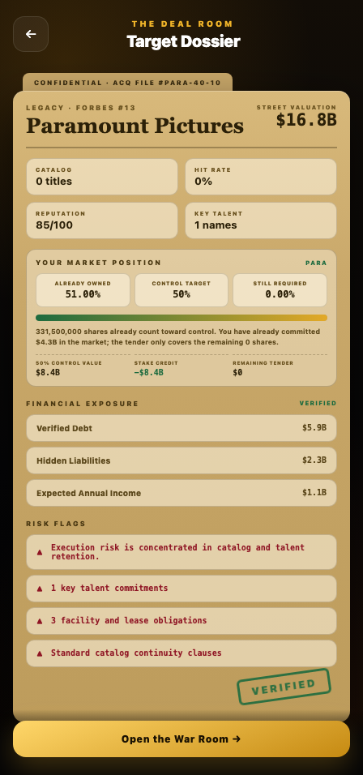

# Public stock-control acquisition bug analysis

Analyzed October 22, 2026. Current checkout: `bb029e5`, package version `1.0.25`, plus pre-existing local changes. No production code was modified for this investigation. Five user-supplied screenshots were treated as reports, not as instructions. No affected player's save, installed build identity or production telemetry was supplied.

## Verdict

**Confirmed P1: an existing DRAFT acquisition case can trap a majority shareholder in a dossier → decision → dossier loop.** The visible accepted decision is synthetic UI state; the persisted case remains DRAFT. This reproduces through the actual `ForbesApp → StudioAcquisitionDesk → StudioAcquisitionDealRoom` React components with production diligence, presentation-save and closing services.

It affects more than Paramount. Controlled browser cases reproduced it for Paramount at 50%, 51% and 100%, and Warner Bros. and Universal at 51%. It does not require huge valuations. A normal $22B Paramount fixture reproduces it.

The reports also expose a separate valuation divergence, recurring reminders, stale negotiation precedence, inconsistent financial terms and a test-coverage gap. Repairing a button alone would leave these related problems.

## Evidence from the reports

| Report | What the screenshot supports | Qualification |
| --- | --- | --- |
| Faraz | Acquiring after buying 100% reportedly fails | Text report; independently reproduced with a paid-diligence DRAFT case |
| Red: War Room | 51% ownership, control secured, $0 remaining tender, $12.9B already invested | Majority ownership and zero remaining price are intended; they do not prove a completed control transfer |
| Red: accepted memo and dossier | $0 accepted memo followed by failure to reach closing; Forbes value $46,438.3B | Exact failure reproduced in current React UI |
| Other player's workaround | Buying through Forbes reportedly works | A durable ACCEPTED case does work in our fixture; entry app alone does not determine success |
| Final screenshot | Verified dossier returns each week; extremely large debt/income/reference figures | Requeue reproduced; huge legacy valuations survive current migration; exact save history unavailable |

## 1. Root cause: local screen and durable case disagree

The failing sequence is:

1. A player holds at least 50% in a supported public studio.
2. Paid diligence creates a persisted case with `status: 'DRAFT'` (`services/studioAcquisition.ts:1024`). This is legitimate: diligence is not seller acceptance.
3. The deal room detects `directControlReady`. Clicking **File Majority Control Notice** changes local phase to BREAKING, but does not create a durable control-ready state or update the case (`StudioAcquisitionDealRoom.tsx:1429`).
4. The UI synthesizes `decision: 'ACCEPTED'` for that shareholder (`:1386`). It can therefore display “the board said YES” without a persisted accepted acquisition.
5. **Review the Board Decision** and **Proceed to Closing** set the local phase, then persist a presentation marker (`:1471`, `:1479`). `updateAcquisitionPresentation` deliberately preserves the original DRAFT status.
6. Those presentation markers are part of `caseKey`. The synchronization effect observes the changed key and calls `setPhase(phaseForCase(acquisitionCase))` (`:1368`).
7. `phaseForCase` only honors saved CLOSING/SIGNING markers for ACCEPTED, COUNTERED, RIVAL_BID and REJECTED. DRAFT falls through to DOSSIER (`:1284`). The player is sent back before the final signing service runs.

The first reveal can reset to dossier. A second attempt can show the accepted memo because the same marker produces no new key; the subsequent closing marker changes the key again and returns to dossier. This explains the apparently inconsistent “sometimes it gets further” behavior.

**Observed failed state:** status DRAFT, presentation `closingStage: 'CLOSING'`, scene `sa-dossier`, businesses empty, shares and cash unchanged. No browser runtime exception is needed: this is an ordinary state transition that chooses the wrong screen.

**Working comparison:** with no acquisition case, presentation persistence is skipped. The player can reach signature; the real completion service creates ACQUIRED, adds the studio and charges no additional purchase price. With an existing ACCEPTED case, the resume resolver also allows closing. These working cases explain why the issue is not universal.

## 2. Browser reproduction matrix

Isolated Chromium, 448 × 956 viewport, synthetic player/save data. Production React components and services were imported without modification. Diligence fixtures were created by the real `runDueDiligence`; accepted/countered/rejected fixtures were constructed explicitly to isolate prior-state effects. Successful cases were clicked through all three closing documents, contract clauses and final signature.

| Studio | Holding | Starting case | Observed result |
| --- | ---: | --- | --- |
| Paramount | 50% | Paid diligence / DRAFT | Returns to dossier after Proceed to Closing |
| Paramount | 51% | Paid diligence / DRAFT | Same loop |
| Paramount | 100% | Paid diligence / DRAFT | Same loop |
| Warner Bros. | 51% | Paid diligence / DRAFT | Same loop |
| Universal | 51% | Paid diligence / DRAFT | Same loop |
| Paramount | 51% | No case | Reaches ACQUIRED; shares preserved; $0 additional purchase price |
| Paramount | 100% | No case | Reaches ACQUIRED; shares preserved; $0 additional purchase price |
| Paramount | 51% | Prior ACCEPTED offer | Reaches ACQUIRED; UI displays stale $1B price but actual charge is $0 |
| Paramount | 51% | Prior COUNTERED offer | Old counter response still takes precedence; no direct closing button |
| Paramount | 51% | Prior REJECTED offer | Old rejection still takes precedence; no direct closing button |
| Artisan Pictures | N/A | Private ACCEPTED offer | Normal private acquisition completes and charges its agreed $1B |

All 11 cases had zero page errors. Four completed acquisitions; five reproduced loops; two demonstrated stale-response precedence. This is component/service browser evidence, not native-device/store-build verification. It does not establish how many production players have the required starting state.

Full state snapshots: [browser-results.json](evidence/browser-results.json).

## 3. Related confirmed defects

### A. Stale negotiation terms override majority control

`decision = sellerResponse?.decision || (directControlReady ? 'ACCEPTED' : 'COUNTERED')` prefers old negotiations. A counter or rejection from before buying the stock can keep the player in that old negotiation UI. A prior accepted offer displays its old price even though direct public-control completion correctly charges zero. This is separate from the DRAFT reset and must be covered by the repair.

### B. Weekly reminders have no effective opened/deferred state

`processStockTakeoverEvents` (`services/stockTakeover.ts:449`) suppresses reminders for owned businesses, explicit dismissal flags and an event already in the queue. Opening the acquisition desk removes the queued event (`App.tsx:3043`) but does not record a notice acknowledgement or defer period. A failed transfer leaves the studio unowned. The next weekly pass queues it again.

The service reproduction gives event counts **1 → 0 after opening → 1 next week → 0 after actual acquisition**. Current production code reads `stockTakeoverEventDismissals`, but the repository search found no normal UI writer that sets a dismissal; migration initializes it and a QA action deletes entries. The acquisition-pressure cadence helper governs other event families and does not throttle this stock-control event.

### C. Control thresholds differ

Forbes/company position and the acquisition backend recognize control at **50%**, while stock takeover routes and automatic reminders use **51%**. Direct service tests confirm 50% can acquire but does not trigger the takeover reminder. This does not cause the reported 51% loop, but it makes entry points disagree and needs one explicit product rule.

### D. Displayed diligence liabilities are not the signed liabilities

For the same fixture, paid diligence reports verified debt **$5.885B**, hidden liabilities **$2.31B**, expected annual income **$1.0692B**. Direct stock-control completion records **$5.5B**, **$0.44B**, and **$0.99B**, respectively.

The presentation uses the diligence report, while `completeStockControlAcquisition` (`studioAcquisition.ts:1953`) recalculates from the public profile and a fixed 2% hidden-liability rate. Without diligence, the new wrapper displays 3.5% hidden liabilities while closing still records 2%. This is a disclosed-terms/settlement mismatch, independent of the loop. These figures are financial exposure, not a second share purchase price.

## 4. The enormous valuation gap is a separate economy problem

The two screens use different sources:

- Stock price × outstanding shares is bounded by `getStockMarketCapCeiling` (`services/stockLogic.ts:114`). Paramount's base is 650M shares × $13 = **$8.45B**, with a 3× ceiling of **$25.35B**. A real purchase at that ceiling costs **$12.9285B for 51%**, matching the reported ~$12.9B scale.
- Forbes takes `world.studios.PARAMOUNT.valuation` in billions and multiplies it by 1B (`services/forbesStudioProfile.ts:204`). Diligence then adjusts that value using estimated cash, debt and liabilities. It is not priced from the linked stock market cap.
- The screenshot's **$46,438.3B = $46.4383T**, about **1,832×** the stock market-cap ceiling. A normal debt/cash bridge alone does not explain this scale. Linked labels also span “Paramount Global” and “Paramount Pictures”, so company scope must be decided explicitly rather than assuming parent equity and a studio enterprise value are identical.

A historical mechanism is verified: the August 12 `907e027` version of `worldLogic` called passive studio valuation compounding every week, in addition to per-release valuation changes. At reputation 100 with no new hits/releases, a controlled replay of that historical passive function grows Paramount from $22B to **$153.162B after 10 years**, **$1,066.065B after 20**, and **$51,649.637B after 40**. This shows the scale can arise from compounding rather than a currency suffix alone. It is a mechanism isolation with fixed reputation/randomness, not a reconstruction of a player's actual 40-year save.

**Current-versus-historical boundary:** that passive call was removed from `worldLogic` in `9b5cf1e` on September 4. Current studio AI finance has a different valuation process; this investigation does not claim that old function still executes in the current weekly path. However, current normalization and `migratePlayerSave` preserve positive inflated valuations. Both $46,438.3B and a synthetic 100 trillion-billion world value survive migration and are accepted by direct control completion. Current AI valuation also has no public-stock valuation ceiling or reconciliation with it.

Consequently, the discrepancy is not merely a formatting bug. Estimated debt, income and acquisition-derived values inherit the inflated basis, and `fmtMoney` prints every large amount in billions without progressing to trillions, worsening readability. Exact causal history of screenshot 5 remains unverified without the player's save and version.

## 5. Why existing audits missed it

Seven relevant existing commands pass despite the reproduced defect:

- `audit:stock-control-acquisition`
- `audit:stock-control-acquisition-ui`
- `audit:studio-acquisition`
- `audit:stock-takeovers`
- `audit:stock-decision-events`
- `audit:entertainment-stocks`
- `audit:acquisition-event-cadence`

The stock-control logic audit directly invokes a completion service that works. Its UI audit (`scripts/audit-stock-control-acquisition-ui.mjs`) reads source files and checks strings such as `showStockControlReview` and `Complete Control Transfer`; it never clicks the production UI. Those strings remain in `LegacyStudioAcquisitionDesk`, while the current exported `StudioAcquisitionDesk` delegates to the cinematic room (`:2421`, `:2551`). Thus passing string checks do not establish that the rendered route reaches the service.

The focused investigation additionally ran **26 service assertions** covering thresholds, zero extra charge, preserved shares, repeat signing after JSON round-trip, presentation status, requeue behavior, liability divergence, actual stock purchase cost and inflated-value migration. Results: [service-results.json](evidence/service-results.json). Existing audit logs and the exact isolated harness/replay sources are retained in `evidence/`. No whole-app build/typecheck was required or claimed for this analysis-only change.

## 6. Proposed repair, in order — not implemented

1. **Make majority-control readiness durable and authoritative.** Introduce or derive an explicit ready-for-control-transfer state from current ownership; support existing DRAFT cases without fabricating a seller's accepted purchase offer. Resume RESPONSE/CLOSING/SIGNING consistently. Revalidate actual ownership at signature and route safely if shares have been sold.
2. **Give current majority control precedence over stale negotiations.** Show $0 additional share price when the threshold is already held. Preserve historical offers as history; do not make the player accept/pay an obsolete counter. Keep normal minority tenders and private acquisition rules intact.
3. **Use one quoted and signed financial summary.** Review, contract and settlement must use the same verified debt/liability/income basis, with any intentional changes visible before signature. Maintain existing acquisition debt ledger safeguards and corporate funding attribution.
4. **Make reminders acknowledgeable and deferable.** Opening/defering a control notice should not generate an immediate identical notice every week. Retain the manual Stocks/Forbes route and re-notify for a meaningful state change. Successful signing must clear matching queued notices.
5. **Reconcile company valuation and scope.** Use a consistent public-company equity basis across Stocks/Forbes/acquisition, and an explicit cash/debt bridge where enterprise value differs. Prevent unchecked growth from being reintroduced. Improve large-number formatting. Assess legacy inflated values with a versioned, evidence-based migration; do not reset all studios to catalogue values or silently rewrite cash, share cost basis, signed debt or historical transactions.
6. **Replace source-string confidence with real flow regressions.** Cover 49.99%, the chosen exact control boundary, 51%, 100%; no case/DRAFT/diligence/accepted/countered/rejected/closed; normal and inflated old saves; low energy; ownership sold before signing; duplicate signature; save/reload at every stage; personal and corporate ownership; private and public tender controls. Verify stock purchase → weekly notice → actual closing → owned studio → save/reload → next week, including native device verification before release.

Expected outcome: a legitimate majority shareholder completes one control-transfer ceremony, pays no second purchase price, retains existing shares/cost basis, gets an owned playable studio, sees accurate signed liabilities, resumes reliably after reload and stops receiving the same weekly prompt. Existing holdings should not need to be sold/rebought or saves restarted.

## Limits and safe interpretation

- Confirmed: current-code UI loop, affected conditional states and three studios, zero-extra-price backend behavior, reminder requeue, stale terms, threshold mismatch, divergent liabilities, separate valuation sources and survival of inflated legacy values.
- Mechanism confirmed but player-specific attribution unverified: historical compounding as the source of the particular extreme screenshot values.
- Not established: affected player count, exact installed release, exact save balances, device-specific behavior, whether every “stock acquisition” report has this same prior case state, or whether real reported invested money was permanently lost.
- Controlled failed loops preserved shares/cash. The invested money remains represented by stock holdings; inaccessible studio control is the reproduced failure. Diligence fees are separate legitimate expenses and were present before loop measurements.
- “Buy through Forbes works” is conditionally consistent with an ACCEPTED-case path, not a universal safe workaround. Both entry points ultimately use the same cinematic room. Skipping diligence is not recommended as a general repair or recovery procedure.

Only this analysis/evidence directory was added. Existing unrelated local changes were preserved. No fix, commit, deployment, save rewrite or user/community message was performed.
