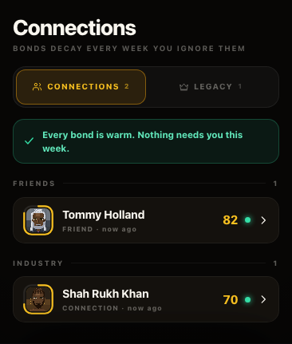
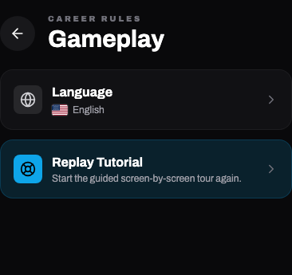

# Built-in name transition — 30 October 2026

Implemented the approved subtle-alias approach in the existing game. No new product screen was added.

## What changed

- 260 reviewed person/creator/credit-name mappings; 158 issued default identities use them. Examples: Tommy Holland, Tom Cruiser, Leon DiCaprio, Christopher Noland, Steven Spielburg, George Cloony, MrBeastly and Mark Robers.
- 239 curated movie/series/roadmap title mappings. Examples: Interstella, Breaking Mad and The Avengars. Existing descriptions retain their canonical translation keys.
- Original entity IDs, seeded stats/portraits, director casting styles, director fame contribution, producer IDs and curated-package investor terms retain their original identity basis.
- A versioned load-time transition updates recognized built-in names/credits. User names, custom titles, captions and unknown/pack identities are preserved. Template variables are interpolated after template aliases, preserving player-written names.
- Country-pack selection/enable controls were removed from Settings. Installed catalogs, flags, receipts, load hydration and succession remain supported. Pack-only saved names remain as issued. Music aliases and unrelated fictional people remain intact.
- The complete mapping is in `services/fictionalNameCatalog.ts`; original names remain internal compatibility keys.

## Verification

| Check | Result |
|---|---|
| Default NPC/creator IDs, order, non-cosmetic hashes | Match frozen issued fixtures |
| Installed actor/director and optional creator catalogs | All 21 countries match issued hashes |
| Famous released/reserved titles and translation continuity | Passed |
| Default franchise roster IDs and signed film/pay schedules | All eight franchises passed |
| Legacy missing-cast fallback, custom names/handles, reserved object-key names | Passed |
| Curated investor offers before/after alias | Identical across 12 weeks |
| Hire → movie → premiere → sequel → production → next weeks | 71 actual weeks, 25 verified save/reloads; actors, cash, shares, contracts and ownership preserved |
| Old saves with/without installed packs | Two six-week routes, nine verified writes each |
| Old verified generation recovery, failed promotion, heir continuation | Passed; 63 installed India profiles retained exactly |
| Ongoing old-display theatrical release versus migrated release | Four weeks of identical cash, gross, studio receipts and fame, with four verified reloads |
| Mobile browser Social and Gameplay | 320px/390px; no page errors or horizontal overflow |
| Existing unrelated dirty tracked files | All 57 initial hashes preserved |
| Full source typecheck | Passed, including the final test additions |
| Production build | Passed with memory guard enabled; 2048MiB heap, 2839.9MiB peak owned-process-tree RSS, no guard stop |

Run the checks with `npm run audit:fictional-names`. The flow entrypoint includes the ongoing-release comparison.

A Node fixture with 3,000 stored projects spent 18.06ms in the name-only projection. After the version flag is set, 10,000 calls took 0.43ms and returned the same object. These are synthetic name-projection measurements, not device/frame or complete save timings.

All gameplay/persistence tests use isolated fixture players and the real game-week/preparation/generation pipeline with a memory-store adapter. No personal save slot was used. Rendering used Chromium mobile viewports.

## Rendered evidence

## Publication candidate verification

The naming-only candidate was exported from published commit `c52896a` with only this feature applied. Pending cinema/save-storage work was excluded. Both the published legacy contract format and the explicit-media saved-contract format have frozen comparison fixtures.

- Full naming audit: passed, including 70 actual production/sequel weeks and 26 verified save/reloads.
- Old-save/pack/heir/recovery and four-week ongoing-release differential: passed.
- Full candidate typecheck: passed.
- Candidate production build: passed with the existing 2048MiB heap and memory guard; peak owned process tree RSS 1856.3MiB; no guard stop.
