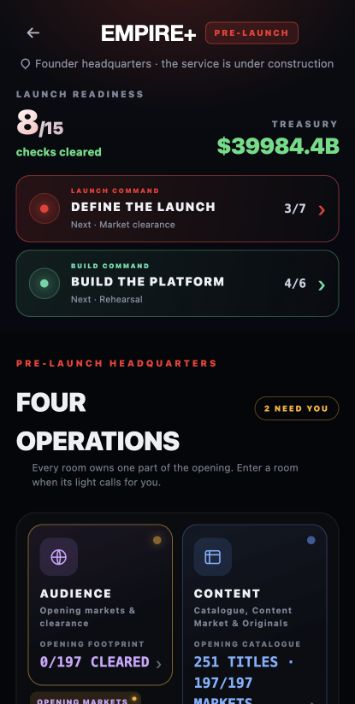
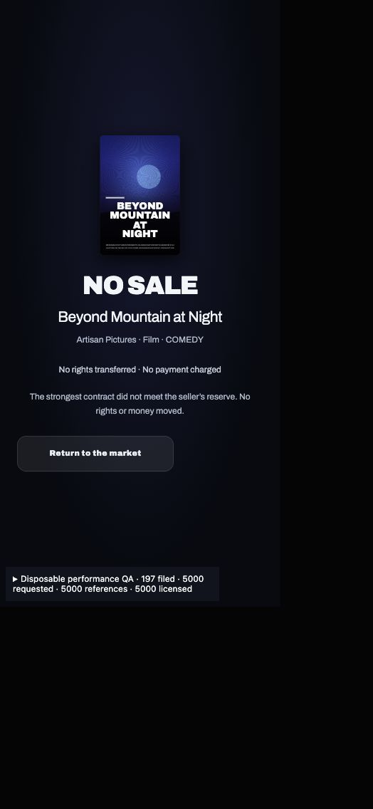

# Streaming offers and 5,000-title performance verification

Status: completed and independently reviewed. Checkpoint pushed; implementation committed locally on `codex/streaming-tap-lag`; port 5174 left ready on the existing Anshu career. Final runtime/source revision: `6a28728`.

## Rollback checkpoint

`d9887b1` (`chore(streaming): checkpoint before UI and 5000-title fixes`) and annotated tag `checkpoint-streaming-ui-collection-performance-fix` were pushed to `origin/codex/streaming-tap-lag` before implementation.

## Controlled comparison

The before and after sequence uses the same pinned disposable 5,000-title fixture: 197 filed countries, 3,983 world projects, 5,000 catalogue references/licences and a 24,041,588-byte serialized player. It extends the prior 1,040-title fixture using distinct synthetic released projects and explicit canonical grants. It is not a history of 5,000 manual purchases.

SHA256: `780d48300344ea931dbbb2a798865a54b0c7f8183c7209f52dc7b9a47f4f7757`.

Production browser, phone viewport 393×852 CSS pixels. Event-to-double-frame observations are single controlled lab samples, not field INP or mobile hardware results. The lab publishes player changes in memory and excludes the main app's durable persistence path. Later long tasks are reported separately so a fast first paint cannot conceal deferred blocking.

| Action | Before | After |
| --- | ---: | ---: |
| Build first open | 5,858.9 ms | 1,253.4 ms |
| Select North America | 16.1 ms | 13.3 ms |
| Add Workhorse in North America | 10,984.9 ms | 628.6 ms |
| Build Money stage | 25.6 ms | 15.3 ms |
| Define first open | 9,458.9 ms | 356.4 ms |
| Define Ident step | 13,336.8 ms | 977.9 ms |
| Bidding amount edits | 70.9–79.3 ms | 13.1–15.3 ms |

Before samples and long-task records are retained in `2026-10-20-auction-result-5000-analysis.json`. Frozen baseline production output is preserved separately from the new build.

## Correctness and handoff

Backend, retention, durability, UI, transaction, final TypeScript/build and production timing checks are complete on `6a28728`. The final whole-change review found one Important permanent outgoing-default regression. Its single correction wave passed the scoped re-review with no new Critical, Important or Minor breakage. The nonblocking audit-portability Minor remains documented below.

No universal Android/iPhone performance claim is made without physical-device verification.

## Completed foundation checks

Performance commits `206e435` and `e0f7873` add caller-owned title/licence/production indexes, batch historical quality reads, reuse compatible coverage/forecasts and remove an unchanged-pricing autosave that unnecessarily incremented revisions. Unknown/non-default canonical fields still invalidate. The complete viewer library remains intact.

Independent complete output comparison against checkpoint-source bundles passed at 1,040 and 5,000 titles: unchanged input, normalized catalogue, canonical rights registry, full opening catalogue and full Build forecast. The 5,000 case retains all 5,000 available titles. Focused audit has 11 passing groups, including actual canonical rack save, Define draft and Ident step paths. Independent task and correction reviews approved the changes.

An intermediate production-browser replay after `e0f7873` measured Build 714ms, region 18.7ms, first rack 306.1ms, Money 19.4ms, Define 350.3ms and first Ident 788.1ms. These are investigation samples; the final combined measurements above supersede these investigation samples. First Ident performs a real canonical reconciliation from no ident to the included silent ident, so it is not a pure free-navigation timing. Initial HQ tasks were 1,037ms and 332ms, before metrics reset; remaining cold work is disclosed rather than hidden behind faster tap readings.

Read-only current-career smoke loaded Anshu bisnoi's slot 2, week 1: 201 catalogue titles and 197 filed markets, with Empire+ treasury visible. The current career differs from older 52/104-title controls. Testing has not advanced its week or made a purchase/scout/offer.

Known baseline audit failures remain separate: `audit-streaming-launch-research-locks` expects a research reason in flattened visible Ident text, where it is exposed in accessible metadata; the exact assertion also fails using the complete `d9887b1` source overlay. The historical interaction audit's invalid $4M bid assertion and the older economy audit are documented in prior reports. Validation must not weaken current rights/fee rules to satisfy those stale expectations.

## Collection negotiation and rights safety

Backend commits `4eebf11`, `8592c90` and `ddd30cf` connect collection submission to delayed weekly replies, revision/counters and the existing atomic package signer. Included component IDs are frozen, while current canonical source ownership, countries, modes, contract windows, money and energy remain action checks. The public opening action resolves current eligible offers by ID and rejects auction-assigned, reserved, stale or fabricated sources.

The source resolver supports world, career and canonical historical titles. It excludes display-only licence fallbacks. A real 24-title Searchlight historical collection completed public submission → actual processed weeks → normalized reload → signing; all 24 titles had canonical contracts, licences and playable ownership. Changing the historical owner before signature refused the entire package.

- Offered/persisted/signed custom guarantee: $123,456,789 at every stage; custom 52-week term and clauses retained. Fee and acceptance energy charged once; duplicate signing after reload did not charge again.
- A $5,123,456,789 aggregate signed without the former five-billion clamp. Exact cancellation allocations also retain their total.
- New money is finite, safe whole USD with explicit limits ($5B individual, $5T collection). Invalid input rejects, rather than silently rounding/clamping. The existing independent fee floor remains enforced.
- New Marketing and success-bonus terms are zero; saved signed Marketing obligations still normalize and enforce their existing penalty once.
- Removed source, changed seller, lost countries, changed inherited viewing rights, an incompatible component or a future conflicting grant refuse without partial ownership/debit.
- Pending collections survive rotation, new producer releases and reload without adding or dropping components. Inherited collection transfers remain unsupported and fail closed; original NPC world/career/historical collection sources work.

Controller duration decision: an original-owner collection's exact agreed term starts at signature. Elapsed reply weeks do not silently shorten it. Fresh canonical rights must cover that entire interval; actual inherited source expiry remains binding. A snapshot offer-lifetime cutoff is distinct from the licence end date.

Covering checks: 32 collection/private groups, 6 individual advertised-offer cases, 12 collection auction checks, Phase A6 rights transactions and Phase16 marketplace/legacy compliance. Independent review found two fresh-validation gaps; both were fixed and re-reviewed. The additional real historical collection blocker was also fixed and re-reviewed. No blocking backend finding remains.

Independent durability evidence: `audit:save-generations` passes. All 5,000 references, full canonical licence terms, every explicitly supplied term, canonical rights registry and treasury are retained through normalize, migration/reload and a real auction tick (21 assertion groups). Complete checkpoint/current 1,040/5,000 opening and forecast hashes still match after backend integration.

## Offer UI and auction presentation

Commits `4f32a30` and `610d364` replace the fixed 250K-only offer editing with exact local whole-USD entry. Fractional, unsafe, malformed and out-of-range drafts cannot submit or silently round. Supported term weeks and clause help are visible. New Marketing controls are removed; inherited clauses, cancellation and legacy support obligations remain accurate and read-only. Live auction custom inputs explicitly require the existing backend's $100,000 increments; private offers accept exact whole dollars.

Collection and title offers both use generic current canonical actions. Saved private offers retain their original IDs and frozen collection membership, including after market rotation. Invalid saved collection snapshots show an unavailable state rather than a crash or a signing action.

The auction result now has a centered poster, static title/winner colour bloom, outcome/title and compact final terms. No-sale no longer shows an empty fee badge or stale live offer feedback. WON/LOST/INVALIDATED/WITHDRAWN and collection presentation have focused render coverage. The small acquired hint remains hidden until presentation and the existing three-second hold/early-skip gate is retained. There is no added gameplay waiting timer.

One batched rendered inspection at 393, 320 and 1024 CSS pixels found no horizontal overflow. The review found inherited resale display/default divergence, and keyboard inspection found that Escape on expanded help dismissed the whole market; both were corrected. One rendered confirmation verified Escape closes help while the editor and exact `123,456,789` draft remain. The fixture key correction has scoped review approval; final full types pass.

Actual production UI service flow, disposable memory only:

| Case | Offered | Reply | Signed result | Treasury after |
| --- | ---: | --- | --- | ---: |
| Three-title Northlight collection | $123,456,789, 52 weeks | Accepted after two actual `processGameWeek` calls | Three licences, exact debit | $49,876,543,211 |
| Individual Dark Garden of Glass 2 | $98,765,432, 52 weeks, renewal/sublicensing | Accepted after three actual game weeks | One additional licence, exact debit | $49,777,777,779 |

Starting treasury was $50,000,000,000. Submission/reply did not debit either proposal. Actual UI proof and exact amounts were captured separately from service audits. No actual-career week/purchase/scout/offer was performed by the controller.

## Additional idle finding

Amount editing improved to 10.6–13.8ms at 5,000 titles, but repeated full-platform work persisted in the active room's timer. A 5,007ms observation contained 24 long tasks of 72–131ms, including short reset-panel overhead. A newly measured frozen-checkpoint 5,001ms window contained 17 tasks of 55–79ms. The clock path normalized the whole platform repeatedly and invalidated presentation memos by replacing player identity. Terminal rooms also retained the interval. This finding was corrected by the timer/draft/cursor work below, with fresh transaction authority preserved. Raw windows are retained; the metrics panel shows only the last 30 entries, so longer overflowing windows cannot be subtracted reliably.

## Completed auction timer and draft work

Commits `504525c`, `f4ddf47`, `7e8865b` and the type-only `7a361d3` close the integrated gaps:

- Clock ticks freshly parse the same bounded session schema, replace only live session state and retain unrelated platform fields/references. Closing, payment, bid, withdrawal, funding and reconciliation semantics retain fresh canonical transaction checks. Terminal rooms stop scheduling, including immediate catchup closure.
- Draft persistence and its scheduling effect share the canonical draft schema and field comparison. Reordered keys/defaults/bounds no longer create a 350ms save loop. Both deep-link entry paths save once; real edits still save. Existing 500-item draft-selection bounds are unchanged and are separate from full catalogue ownership.
- Caller-owned presentation cursors retain a stable projection source plus the latest comparison baseline. A normalized save is compared once; later clock updates do not repeatedly serialize the old/new 5,000-title arrays. Each cursor retains at most two players, no history or global player cache. Current authority changes invalidate; actions never use these cached projections.

The actual parent test went from 45,000 licence-field reads across three post-compaction ticks to zero reads and zero catalogue-array serializations. Fifteen timer/parent/cursor groups cover original clock/rival/anti-sniping/catchup/settlement parity, current grant/cash refusal, delayed clicks, reload retention, malformed sessions, both entry paths, real draft edits, cursor mode/invalidation and bounded retention. Independent task and all three correction reviews approved the source.

Final production `6a28728` 5,000-title room observation: six amount edits **13.1–15.3ms**, with no observed long tasks in that edit window. A subsequent **5,001ms active-room idle window had two long tasks of 55ms and 54ms (109ms total)**. The frozen checkpoint's matched 5,001ms idle window contained **17 tasks of 55–79ms, totaling 1,192ms**. That is about 91% less measured long-task time in these two short windows; it is not a percentile or a promise of zero work on every device. An earlier intermediate revision observed zero tasks in its own five-second window; the final-source result above supersedes that observation, so zero idle blocking is not claimed.

## Remaining cold work and validation limits

Initial HQ startup before metrics reset still contained 882ms and 316ms tasks. The room's pre-reset record contained 714 / 190 / 75 / 128 / 54 / 56 / 55ms tasks; that record also includes live-room activity before reset, so it is not a pure startup-only measurement. First Build remains about **1.25s** with 5,000 titles, first Ident about **0.98s**, and a real rack save about **0.63s**. First Ident performs a real canonical ident reconciliation, not just free navigation. Final wizard long tasks remain visible in the JSON: 1,243 / 125 / 499 / 319 / 57 / 396 / 579ms. The optimization removes repeated work and improves navigation; it does not make every cold calculation instant. Further reduction would require reducing or moving the remaining initial country/coverage/customer-forecast work, with separate correctness and device measurements.

Browser timings, fresh full typecheck and production build all use final implementation `6a28728`. The lab excludes App/disk persistence and uses a synthetic stress fixture; 5,000 manual acquisitions and physical Android/iPhone performance have not been claimed.

Anshu's current slot 2 was reloaded and read-only navigation verified at year 15/week 1, **251 titles**, 197 filed markets and visible Empire+ treasury. The user acquired an additional MGM collection during the session, so this current count differs from the earlier 201-title observation. The controller made no actual-career purchase, scouting, proposal or week-advance action. Both wizards rendered, and the career was left at headquarters. The original browser tab was no longer in the available browser session; the final handoff uses a fresh local tab with the existing career.

## Final review correction and rights proof

The final whole-change review covered `d9887b1..7a361d3`: no Critical, one Important, one nonblocking Minor. `6a28728` corrects the Important and its observed settlement defects. The single scoped re-review approved the correction, with no new Critical, Important or Minor breakage. Earlier task reviews also approved the indexed reads, current-source collection validation, historical-source support, inherited-term UI/Escape handling and timer/draft/cursor corrections.

Owned permanent rights expose a canonical `MAX_SAFE_INTEGER` expiry; copying that number into a newly strict 1–520-week editable duration had prevented both advertised outgoing transfer and sublicense from opening. The form now uses a bounded representation while canonical permanent expiry remains permanent. The generic duration validator is unchanged. Actual transfer/signature preserves original inherited clauses, access grant and legacy obligations. Permanent sublicensing now checks the entire perpetual interval at the transaction boundary and records that same interval in the receipt. Current-source guards stop missing/closed/wrong-holder/changed-grant authority from settling or falling through into acquisition.

The new audit first reproduced both broken default openings (finite 101-week controls already passed), then exposed the split finite receipt and changed/missing-source acceptance. Final **12/12** cases cover real default opening → delayed review/counter → accept → actual signing → normalized reload → duplicate signing for both outgoing paths; canonical/local/receipt perpetual expiry; exact once-only cash settlement and unchanged outgoing energy; inherited Marketing obligations; missing/closed/changed holder/modes/countries/window refusals; conflicts starting 600 weeks later through both wrapper and direct transaction; and malformed/out-of-range finite inputs. The stricter source guard initially rejected a legacy empty-viewer transfer, caught by Phase A6; the final guard preserves that exact inherited grant without creating viewing modes. Phase A6 and Phase16 subsequently passed with their existing expectations intact.

Focused covering commands (all exit 0 on final source):

```sh
NODE_OPTIONS=--max-old-space-size=8192 node_modules/.bin/tsc --noEmit
npm run build
node scripts/audit-streaming-auction-timer.cjs
node_modules/.bin/esbuild scripts/audit-streaming-permanent-outgoing.ts --bundle --platform=node --format=esm --loader:.csv=text --outfile=/tmp/streaming-permanent-outgoing.mjs
node /tmp/streaming-permanent-outgoing.mjs
```

The permanent audit adds no UI/persistence-schema change. Full-app TypeScript's 8GB setting is build-tool headroom, not a runtime memory requirement.

## Final checks and standing observations

- Fresh `NODE_OPTIONS=--max-old-space-size=8192 node_modules/.bin/tsc --noEmit`: exit 0. Fresh `npm run build`: exit 0. TypeScript inference at the React ref boundary is explicitly typed; no `any`, ignored errors or runtime workaround was added.
- Thirteen focused controller audit commands pass: collection-private, offer-editor UI, result UI, indexed reads, independent retention, full checkpoint/current parity, individual listed terms, collection auction, rights transactions A6, rights marketplace/legacy Phase16, presentation hold/skip, launch draft continuity and durable save generations. The additional final timer/parent/cursor audit passes 15/15, and the final permanent-outgoing audit passes 12/12. The controller reran all of these on `6a28728`, separately asserted full baseline/current parity, and verified the pinned fixture SHA256 unchanged.
- All 5,000 references, full canonical licence terms, every explicit input term, canonical registry and treasury survive normalization, migration/JSON reload and a real auction tick. Complete 1,040/5,000 opening and Build forecast hashes match the independently bundled checkpoint. An initial retention assertion expected the clock to inject optional defaults; exact diagnosis showed raw licences identical, zero explicit changes and equal canonical forms. The corrected independent oracle still checks every raw explicit field as well as full canonical equality.
- Builds retain the existing stale Browserslist database and large-chunk notices. Final application main chunk: 14,167.82kB / 3,955.84kB gzip. Audit-runner bundle notices also remain visible. No warnings or diagnostics were suppressed.
- Design-hook findings on incumbent Inter usage and side accents predate this task and remain standing. No unrelated font redesign, `ignore-file`, `ignore-rule` or narrow ignore was added. The subtle outcome colour bloom is the requested design.
- Known baseline research-copy, stale invalid-money interaction and older economy assertions remain documented separately; passing the focused scope does not claim the entire repository's unrelated audits are green.

The agreed original-owner collection duration starts at signature and is never silently shortened by reply weeks. Fresh rights must cover the whole interval; inherited expiry remains binding. If that policy interpretation is wrong, it needs an explicit visible counter/revision rather than hidden shortening.

[Machine-readable measurements](2026-10-20-streaming-offers-performance.json)





Final-review minor retained: `scripts/audit-streaming-5000-read-index.ts` requires `/tmp/streaming-stress-5000-player.json`; optional `STREAMING_5000_BENCH=1` additionally requires `/tmp/task1-baseline-projections.json`. Those pinned local artifacts remain on this machine, but a clean checkout needs separate fixture/baseline preparation. Current evidence is valid; portable fixture-path/preparation support is deferred.


## Handoff and review record

All implementation commits are preserved locally through `6a28728`; only the requested pre-fix checkpoint/tag is pushed to GitHub. No PR or merge was created. Local Vite PID 57591 listens on 127.0.0.1:5174 and its cwd is this repository. The visible browser is left on Anshu bisnoi's Empire+ headquarters; the temporary phone viewport was reset and disposable QA tabs/servers were closed. This verifies the rendered career and correct checkout, not just an HTTP response.

The complete policy ruling is preserved above: exact agreed original-owner collection duration starts at signature, fresh authority must cover the entire interval, inherited expiry remains binding, and offer lifetime is separate. If the policy should start at proposal instead, the cost is an explicit visible counter/revision policy change; silently shortening accepted terms would be wrong. No other controller ruling or parked Critical/Important finding remains.
